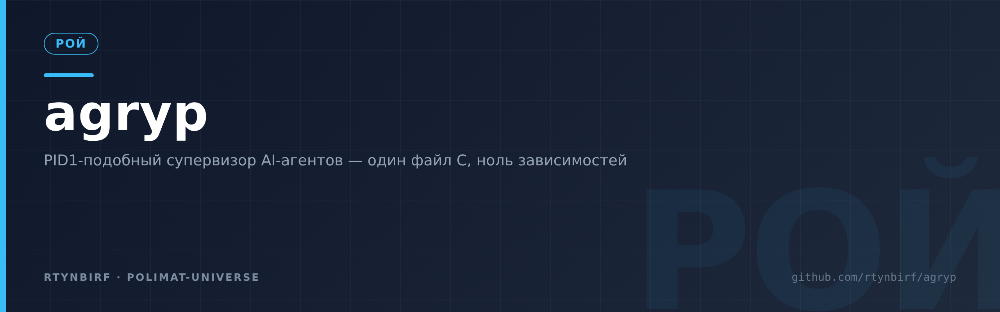

<div align="center">
  
</div>

# agryp — неспящий супервизор агентов уровня PID 1

<p align="center"></p>


**Агенты умирают в закрытых терминалах. agryp — не спит.**

`agryp` — минимальный init-супервизор, который запускает AI-агентов как процессы
первого класса: с политикой перезапуска, бюджетом попытки и graceful shutdown.
Один файл C, только libc, ноль зависимостей — этика LFS: собрано с нуля,
ничьего чужого.

## Почему имя — agryp: урок «идиота»

Подсказка заказчика: «посмотри, как занято слово ἰδιώτης». Проверили —
занято даже на PyPI (пакет `idiotes`, 2024, с описанием «частное лицо, не
участвующее в общественных делах»). Урок принят: словарные греческие и
латинские слова выжжены насквозь — брендовым мусором занято всё, вплоть до
абсурдных слов.

Но семантика подсказки — диагностична. **ἰδιώτης** (от ἴδιος — «свой,
не-публичный, не-разделяемый») — это «частник»: не выходит на агору, никого не
пасёт, полезен только себе. Перикл в надгробной речи говорил о таких: кто не
участвует в общих делах — «бесполезен» (ἀχρεῖον). Это точный диагноз агентскому
стеку топ-100 GitHub (40 из 100 репо): агентские процессы — ἰδιῶται, частники в
личных терминалах, не участвующие в общей жизни машины.

Антидот — из того же языка: **ἀγύπνος** — «неспящий» (ἀ- + ὕπνος, бог сна
Гипнос). Так звали неусыпных: монахи-«бессонные» (ἀκοίμητοι, akoimetoi) с
начала V века держали службу посменно, день и ночь — службу, которая не
останавливается никогда. Словарь при этом даёт точное определение нашей
функции: **agrypnode** — «любой агент, вызывающий бодрствование».

Имя: стем **agryp** (от ἀγύπνος) в юникс-фонетике — ряд grep / grip / crypt:
5 букв ASCII, читается «АГ-рип», без культурного багажа и сленговых ловушек,
агент-парсится и компонуется (`agrypctl`, `agryp-unit`).

Квитанции проверок (ноябрь 2026):

| Кандидат | Что нашла сеть | Вердикт |
|---|---|---|
| `idiotes` | пакет на PyPI | занят |
| `protagon` | protagon.space, Protagon USA | занят |
| `agentor` | 3 проекта, вкл. crates.io-рантайм для агентов | занят |
| `moirai` | Salesforce Moirai 2.0 | занят |
| `pidgen` | PyPI pidgen2, PIDgen.dll Windows | занят |
| `agrypnos` | мод Slay the Spire на GitHub | занят |
| `agryp` | только никнеймы на форумах; ноль в GitHub/npm/PyPI/crates | **свободен** |
| `pidfather` (было) | свободен, но бренд «для людей»: мем с крестным отцом | заменён |

## Семантика имени — это же спецификация

- **не спит**: `poll()`-цикл с дедлайнами бюджета — сутки напролёт, как у
  монахов-«бессонных» (akoimetoi);
- **служба не прерывается**: `restart = always` — попытка за попыткой, смена за сменой;
- **казначей бодрствования**: `budget-sec` — попытка дольше лимита усыпляется SIGKILL-ом;
- **собирает мёртвых**: `waitpid(-1)` — зомби не копятся;
- **готов стать PID 1**: в контейнере усыновляет осиротевшие процессы сам.

## Почему это не велосипед

Топ-100 GitHub на 2026-11-06 (см. `docs/top100-by-category.md`):

| Категория | Репо из 100 |
|---|---|
| AI-агенты и скиллы | 31 |
| ML-модели и инференс | 9 |
| **Агентский стек всего** | **40** |
| Из них на уровне процессов (init/supervisor/pid) | **0** |

Полный свод инструментов-исполнителей — **2444 позиции, 34 категории, без дублей**, всё по алфавиту: [`docs/tool-catalog.md`](docs/tool-catalog.md), машиночитаемая версия — [`docs/tool-catalog.csv`](docs/tool-catalog.csv).

Весь агентский стек списка живёт в userland: скиллы (№12, 13, 20, 36, 48, 62, 99),
CLI-агенты (№22, 56, 79, 93), воркфлоу-платформы (№25, 51, 55), обвязка LLM (№65, 68).
Их запускают руками из терминала; закрылся терминал — агент умер; агент завис —
никто его не убьёт и не поднимет.

Ближайшие аналоги и почему это не они:

- **systemd / supervisord** — знают процессы, но не знают агентов: нет понятия
  «бюджет попытки», нет формата `.agent`, нет подсчёта попыток.
- **Оркестраторы уровня фреймворков** (LangGraph Supervisor, Paperclip и т.п. —
  то, что выдаёт поиск в 2026-м) — про агентов знают всё, но живут *внутри*
  приложения, а не на уровне процессов: их «супервизор» умирает вместе с процессом.
- **Сверстники-2026 процессного слоя** (zeptopm — PM2 для LLM; stdiobus —
  NDJSON-роутер; lemon/spectre — BEAM) — доказывают спрос, но живут на
  рантаймах и сокетах: нет ни одного из пяти свойств agryp (живая сверка —
  `docs/TEACHERS.md` §V).

`agryp` занимает клетку, которую не занял ни один из них:
**PID1-ядро жизненного цикла агента**.

Сверка со средой обитания ([`docs/TEACHERS.md`](docs/TEACHERS.md)):
учителя — systemd, s6, runit, tini, supervisord, Kubernetes, launchd;
сверстники-2025/26 app-уровня — Claude Code, Codex, MCP, LangGraph,
E2B/Modal, OTel GenAI, OpenHands, Letta. Принято четыре инварианта
(лестница перезапуска, предохранитель crash-loop, subreaper, PDEATHSIG),
семь подтверждены как «уже было», остальное отвергнуто с причинами —
сингулярность держится на отказах не хуже, чем на принятиях.

Живая сверка ниши (2026-11-07, GitHub API с токеном Хозяина,
[`docs/TEACHERS.md` §V](docs/TEACHERS.md)): процессный слой для агентов
возник — zeptopm («PM2 для LLM», Rust), stdiobus (C-роутер NDJSON),
lemon и spectre (Elixir/OTP); уровнем выше — paperclip ★111k, herdr ★48k,
openhuman ★42k, agent-orchestrator ★14k. Ниша размечена слоями, и клетку
PID1-ядра жизненного цикла не занял никто: у сверстников нет ни одного
из наших пяти свойств — один файл C, ноль зависимостей, файл-как-API,
самоверифицирующийся журнал, гарантии ядра (группа попытки, subreaper,
PDEATHSIG, клетка cgroup).

## Формат юнита `.agent`

```
# examples/hello.agent
name         = hello
exec         = bash demo/hello_agent.sh
restart      = always       # always | on-failure | no
budget-sec   = 25           # time-бюджет попытки (Ст. 7)
token-budget = 5000         # токен-бюджет: burn-rate агент отдаёт сам (Ст. 14)
cooldown-ms  = 1000         # база лестницы перезапуска (Ст. 8)
# finish       = rm -rf /tmp/$AGRY_UNIT-worktree   # хук после каждой смерти (Виток 6)
# finish-timeout-ms = 600  # потолок хука per-unit, 0/нет = дефолт 5000 (Виток 11, s6 timeout-finish)
# mem-max-mb = 64           # клетка cgroups v2 (Ст. 15), 0 = без клетки
# jail       = pid,mount    # комнаты имён попытки: pid | mount | pid,mount (Виток 7)
# max-attempts = 0          # 0 = без лимита
```

## Быстрый старт

```
make && ./agryp --dir examples
# другой терминал — живой NDJSON-срез семьи (Ст. 13):
./agryp status --dir examples
# остановить/поднять юнит — файл-договор, не сокет (Виток 5):
./agrypctl stop hello     # кладёт examples/.agryp-ctl/hello.down → ctl-down
./agrypctl start hello    # снимает → ctl-up, новая попытка
# поменять бюджет/добавить/удалить *.agent и перечитать договоры без смерти детей (Виток 6):
kill -HUP $(pgrep -f 'agryp --dir examples')
```

Логи — JSON-строки в stdout (`boot`, `spawn`, `exit`, `restart`, `stopped`,
`failed`, `budget-kill`, `token-kill`, `ctl-down`, `ctl-up`, `ctl-drop`,
`ctl-kill`, `finish`, `reload`, `ready`, `unit-added`, `unit-removed`,
`cgroup-skip`, `jail-skip`, `report-drop`, `subreaper`, `reap-orphan`,
`shutdown`, `summary`) — удобно направлять в любой сборщик.

## Живое демо: что доказывает транскрипт

Сценарий (`make demo`): поднимаются два агента; на 5-й секунде мы убиваем
`hello` через `kill -9` всей группе процессов; на 15-й снимаем `agryp status`
в живой семье; на 25-й `crashy` добирается до терминального `failed`;
на 35-й супервизору уходит SIGTERM.

Факты из `demo/demo-transcript.jsonl` (реальный прогон 2026-11-07):

- Ст. 15 в песочнице: `cgroup-skip` (cgroupfs read-only, errno 30) — лимит
  памяти объявлён вслух, супервизор работает дальше;
- Ст. 9 при загрузке: `subreaper` с `"on":true` — супервизор объявил себя
  собирателем сирот; каждый ребёнок уходит в жизнь со страховкой
  `PR_SET_PDEATHSIG`;
- внешняя смерть поймана: `"event":"exit","by_signal":9` → `"event":"restart"`
  с `backoff_ms:1000` — база лестницы;
- Ст. 8, лестница `crashy`: `backoff_ms` 1000 → 2000 → 4000 → 8000
  (streak 1→4), пятая своя смерть — терминальный `failed` (streak 5) и
  `stopped reason crash-loop`; спавнов после `failed` — ноль;
- Ст. 8, лестница `hello`: казни закона её не растят — после двух
  `token-kill` юнит продолжает с базой 1000 мс; попытка, прожившая
  ≥ 10 с, гасит счётчик (`streak` 1 → 0);
- Ст. 14: hello дважды усыпан токенами — 2 × `token-kill`, оба при
  `tokens:5000 == budget:5000`; `budget-kill` — 0: токены дороже 25 секунд;
- Ст. 13: `demo/status-snapshot.jsonl` — срез в t=15: `crashy` RUNNING
  (attempt 4, streak 3 — на верхней ступени перед падением), `hello`
  RUNNING 4500/5000 — за 0,3 с до казни;
- graceful shutdown: TERM → ожидание → KILL, затем честный summary:

```
{"unit":"crashy","event":"summary","attempts":5,"exits_ok":0,"exits_fail":5,"budget_kills":0,"token_kills":0,"tokens_total":0,"restarts":4}
{"unit":"hello","event":"summary","attempts":4,"exits_ok":0,"exits_fail":4,"budget_kills":0,"token_kills":2,"tokens_total":17000,"restarts":3}
{"event":"shutdown","reason":"signal"}
```

Бонус, найденный при переименовании: вывод агентов и JSON-логи родителя идут в
один файл, поэтому `agryp` выставляет `O_APPEND` на stdout при старте — флаг
наследуется детьми через fork+exec, и все записи атомарно идут в конец. Без
него stdio родителя пишет по устаревшей позиции, пока дети уехали вперёд — в
логе появляются разреженные дыры из NUL-байтов (44 КБ мусора в первом прогоне
после рефакторинга имён). Транскрипт теперь — 6.6 КБ: 43 JSON-события + 43
строки агентов одним файлом, ноль NUL; это проверяет аудитор
`demo/audit_transcript.py` — он же сверяет каждую ступень лестницы с конфигом
юнитов и терминальность `failed`; `make audit` печатает `OK`.

## agrypctl: руки без сокетов (Виток 5)

Управление юнитом — без сокетов, FIFO и HTTP, только файловая система
(школа s6-svc): `agrypctl stop <unit>` кладёт `<dir>/.agryp-ctl/<unit>.down`
— супервизор в ближайшей итерации казнит попытку TERM'ом группы и
замораживает restart-политику, пока файл жив (события `ctl-down`, остановка
с `reason:ctl-down` — казнь закона, лестницу не растит); `agrypctl start`
снимает файл — `ctl-up` и новая попытка с чистой лестницей, минуя cooldown.
`.down` с прошлой жизни уважается на boot: юнит не встаёт до снятия файла.
`agrypctl status` не дублирует Ст. 13 — читает тот же файл семьи. Сам
`agrypctl` — один POSIX sh-файл, ноль зависимостей кроме coreutils;
запись файла-договора атомарна (tmp + rename, как у статус-среза).

Дисциплину доказывает второе демо (`make demo-ctl && make audit-ctl`):
worker казнён без единого рестарта, сосед-ghost не тронут (заморозка
пер-юнит), после start — attempt 2; сирот 0. Аудитор знает ctl-события
и ловит подделки: спавн при живом .down, ctl-up без ctl-down и ctl-kill
без трупа — отрицательный тест `demo/negative_ctl_test.py` скармливает
ему все три и требует точного приговора.

## Чистота между смертью и рестартом (Виток 6)

Три урока учителей одним витком, тремя атомами:

- **finish-хук** (школа s6 `./finish`): ключ `finish = <строка sh>` —
  после КАЖДОЙ смерти попытки, до лестницы перезапуска; хук получает
  env `AGRY_UNIT`, `AGRY_EXIT_CODE`, `AGRY_BY_SIGNAL` и живёт вне
  группы попытки (казнь группы его не трогает); потолок — per-unit
  ключ `finish-timeout-ms` (Виток 11, школа s6 `timeout-finish`;
  0/не задан = дефолт ядра `FINISH_MS` 5000), упор — громкое событие
  `finish` с `"timeout":true,"ms":<потолок юнита>`; сбой
  хука лестницу не трогает. Типовое применение фермы:
  `finish = rm -rf /tmp/$AGRY_UNIT-worktree` — каждый новый заход
  агента начинается в чистом рабочем пространстве
  (`make demo-finish`: 3 смерти → 3 хука, след уборки в
  `demo/finish-sweep.log`).
- **Эскалация ctl-stop** (школа systemd `TimeoutStopSec`): агент,
  игнорирующий TERM (`trap '' TERM`), живёт ровно `GRACE_MS` с момента
  `.down`, затем `ctl-kill` и SIGKILL группы — остановка доводится до
  конца даже упрямым; казнь закона лестницу не растит. Нюанс юнит-автору:
  trap обязан жить в лидере группы — `exec = . script.sh` (source),
  иначе `sh script.sh` плодит второго dash, а казнят по лидеру
  (`make demo-ctl`: stubborn получил ctl-kill через 3006 мс и умер по
  сигналу 9 без рестартов).
- **SIGHUP-reload** (школа systemd daemon-reload): `kill -HUP` —
  каталог `*.agent` перечитывается без смерти детей; изменённые ключи
  применяются сразу (дедлайн бюджета пересчитывается от живой попытки),
  новый `*.agent` — юнит появляется и стартует (с комнаткой cgroup,
  Ст. 15), удалённый — graceful-stop (`stopped reason reload`);
  событие `reload` несёт числа добавлено/изменено/удалено, аудитор
  сверяет их с юнит-событиями (`make demo-reload`: бюджет 5→60 на той
  же попытке, beta удалён graceful, gamma добавлен — reload 1/1/1).
  Перезапуск конкретного юнита — не здесь, это agrypctl stop/start.

## Готовность: файл-как-API (Виток 11)

`sd_notify` говорит сокетом, s6 `notification-fd` — пайпом; весь мир
строит мосты между сокетами. Здесь готовность — файл-договор, как всё
в этом доме (Ст. 13): каждая попытка получает env `AGRY_READY_PATH`,
агент, ставший готовым, создаёт файл (`touch "$AGRY_READY_PATH"`),
супервизор даёт событие `ready` с честной задержкой от старта попытки
(`ready_ms` — и в журнале, и в срезе статуса). Мёртвая попытка не
остаётся «готовой»: ready-файл снимает супервизор при смерти и при
новом спавне — чужой или старый файл попытку не переживает. Молчун не
готов — и это факт, а не нарушение: готовность объявляется, а не
додумывается (`make demo-ready`: quickready объявился за 501 мс,
neverready честно 0; аудитор сверяет ms с хронологией spawn→ready).

## Виток 7: клетка имён, токен-будильник и мост на язык systemd

Три функции третьего витка, исполнены автором лично (коллеги не делают):

- **Namespace-клетка попыток** (`jail = pid | pid,mount`): вход в новую
  pid-комнату — только родиться в ней, поэтому вместо `fork()` —
  `clone(CLONE_NEWPID[|CLONE_NEWNS])`: ребёнок супервизора и есть PID 1
  своей комнаты, а геометрия попытки не меняется — та же группа
  (`kill(-pgid)` режет семью и сквозь стену), тот же `PDEATHSIG`, тот же
  `waitpid`. Mount-ветка сразу делает `/` рекурсивно private —
  propagation наружу закрыт. Это не Docker: без образов, сетей и слоёв;
  user-ns не трогаем. Среда не дала unshare — loud `jail-skip` с errno
  и работа дальше без клетки, как у `cgroup-skip` (Ст. 15):
  `make demo-jail` — в песочнице `jail-skip` с errno 1, юнит живёт,
  сироты 0; аудитор ловит «молчаливую усечку» и «двух правд».
- **Токен-будильник** (Ст. 14, тикет 009): квант итерации 250 мс съедал
  латентность казни — агент, жгущий 10k токенов/с, умирал с задержкой
  до тика. Теперь агент после записи рапорта бьёт `SIGUSR2` супервизору
  (пид — в env `AGRY_SUPER_PID`); файл остаётся единственной правдой,
  сигнал — только звонок (тот же приём, что у статус-среза, Ст. 13).
  FIFO отвергнут: в этом доме сокет, FIFO и HTTP запрещены. Старый
  протокол работает как работал: молчащий агент собирается раз в
  итерацию. Доказательство — `make demo-stream`: стример жжёт 20k
  токенов/с, казнь приходит в пределах кванта от пересечения (прогон:
  < 5 мс, в token-kill tokens = 5000 — ровно линия; приёмка ≤ 300 мс).
- **Мост на язык systemd** (тикет 008): у фермы с systemd уже есть
  супервизор — не пере-делывать его (Ст. 5), а разговаривать на его
  языке. `tools/agent2unit.sh` и `tools/unit2agent.sh` (POSIX sh) —
  файл порождает файл; ядро не растёт ни на строку. Эквивалентность
  не обещается — обещается честная таблица потерь; test туда-обратно:
  `make bridge-test` (systemd-analyze verify — зелёный).

Таблица соответствия и потерь (мост, тикет 008):

| `.agent` | `.service` | Потеря |
|---|---|---|
| `name` | имя файла + `Description=agryp unit …` | — |
| `exec` | `ExecStart=/bin/sh -c '<exec>'` | — |
| `restart` | `Restart=` (always/on-failure/no) | — |
| `budget-sec N` | `RuntimeMaxSec=N` / `infinity` | у нас SIGKILL группы попытки, у systemd TERM→KILL сервиса |
| `cooldown-ms` | `RestartSec=` (с точностью до мс) | — |
| `max-attempts N` | `StartLimitBurst=N` + `StartLimitIntervalSec=0` | у systemd — в окне интервала, у нас — за жизнь юнита |
| `token-budget` | — | у systemd нет второй валюты: честно в шапке .service (Ст. 14) |
| `mem-max-mb` | `MemoryMax=N M` | — |
| `finish` | `ExecStopPost=/bin/sh -c '…'` | env: у нас `AGRY_EXIT_CODE`/`AGRY_BY_SIGNAL`, у systemd `$EXIT_CODE`/`$EXIT_STATUS` |
| `finish-timeout-ms` | s6 `timeout-finish` (файл в servicedir) | у systemd потолок ExecStopPost не настраивается per-unit; дефолт 5000 = канон s6 |
| — | `Type=notify` / `sd_notify READY=1` | готовность — файл-договор: env `AGRY_READY_PATH`, готов = создал файл (Виток 11) |
| `jail` | — | комнаты имён не переносятся: это не контейнер |
| — | `WorkingDirectory=` (каталог .agent) | обратная трансляция cwd не восстанавливает — это не договор |

## Бенчмарк витка 8: числа против сверстников

Одинаковая ферма 100 тихих агентов, одинаковые испытания (протокол —
`docs/spec/TZ-8.md`, полная таблица с границами честности —
`docs/BENCHMARK-8.md`, сырые числа — `docs/bench/*.jsonl`):

| | agryp | stdiobus v2.0.3 |
|---|---|---|
| бинарь | **39 800 Б**, libc only | 97 032 Б, +pthread+rt |
| RSS фермы 100 | **1 936 КБ** | 3 016 КБ |
| сироты после kill -9 супервизора | **0 из 100** | 100 из 100 |
| рестарт убитого агента | да (101-й spawn) | да (101-й Worker started) |

Граница названа честно (Ст. 11): агент, породивший собственных детей,
оставляет их сиротами при kill -9 супервизора (PDEATHSIG — один
уровень; тот же предел у tini). Дом-ответ — `jail = pid`: смерть init
pid-комнаты убивает всю комнату — и в витке 9 это принято числами
(M8, `make demo-jail-host`): контроль без клетки — 20 сирот из 20,
`jail = pid` в userns-обёртке среды — 0 из 20, ядро не менялось
(Поправка №10). zeptopm в замере не участвовал:
релизов нет, тулчейна нет; их README-числа — в BENCHMARK-8.md с пометкой
«их слова».

## Подписанные конверты ed25519 и A2A AgentCard (П37, волна ×6)

Конверты крови/событий клетки подписываются **настоящим ed25519**
(RFC 8032). Примитив — вендоренная verbatim реализация orlp/ed25519
(zlib, лицензия и provenance — `vendor/ed25519/VENDOR-NOTES.md`),
собранная из локальных файлов в единственный CLI границы клетки
`tools/ed25519tool` (ядро `src/agryp.c` не выросло ни на строку;
`ldd` → только libc — Ст. 1/2 целы, Поправка №12). Правильность
доказана машиной векторами RFC 8032 §7.1 (TEST 1/2/3 — до последнего
байта) и перекрёстной сверкой с python-cryptography.

- **Завод юнита решает подпись**: `OverseerGate` (`tools/signed_envelope.py`)
  проверяет конверт fail-closed — подделка любого байта payload, чужой
  ключ, повтор `seq`, незнакомый алгоритм, мусор, даже отсутствие
  примитива — `RefusedUnit`, отказ завода юнита. Ключи заперты списком
  доверия при рождении клетки, цепь `seq` обязана расти (replay закрыт):
  супервизор, которому можно верить без сети. Легаси-конверты ×4
  (sha256-wots) проверяются честно, но в ed25519-дверь по умолчанию
  не входят.
- **A2A AgentCard из коробки**: `./agrypctl card` (≡
  `./agrypctl status --card`) строит карту из живого статуса супервизора
  и свежего `.agryp-metrics.prom` и валидирует её схемой
  `schemas/a2a-agentcard.schema.json` до выдачи — карта либо живая и
  валидная (identity/skills/endpoints, `x-agryp.signing: ed25519`),
  либо её нет; endpoint — живой `file://` артефакт (Ст. 13).
- Приёмка: `make test-p37` (42 теста: RFC-векторы, fail-closed-матрица,
  схема, дрейф копии схемы заперт) и `make demo-envelope` (годный
  ed25519-конверт заводит юнита живьём; подделка/чужой ключ/повтор/легаси
  — отказ; `agrypctl card` из живого супервизора). Тестовые ключи —
  одноразовые генераты, помечены TEST ONLY; рабочих ключей в репо нет.

## Конституция

Правила репозитория — в [`CONSTITUTION.md`](CONSTITUTION.md): 16 статей в
пяти разделах (Тело · Дело · Люди · Процесс · Поправки), и каждая статья
снабжена командой проверки — статья без команды проверки не считается
статьёй. Поправка №1: потолок Ст. 1 поднят 512 → 576 — цена трёх статей
процесса (Ст. 13–15). Поправка №2 («урок учителей», 2026-11-06): Ст. 8
получила лестницу перезапуска с предохранителем, Ст. 9 — страховку от
сирот (PDEATHSIG + subreaper), Ст. 1 — потолок 576 → 608; всё одним
атомом кода, статей и проверок по процедуре Ст. 16, источник —
[`docs/TEACHERS.md`](docs/TEACHERS.md). Аудит «журнал не лжёт»
(Ст. 6) — отдельная цель:

```
make audit
```

Конституция — не декорация. Первый же прогон демо под новой конституцией
вскрыл нарушение Ст. 9 («детей не бросаем»): супервизор бил по одному pid
и сиротил потомков агента — в системе жили 20 осиротевших `hello_agent.sh`
из прошлых прогонов, продолжавшие жечь CPU и писать в транскрипт. Фикс:
попытка стала группой процессов (`setpgid` в ребёнке и родителе,
`kill(-pgid)` в бюджет-килле и shutdown), а `run_demo.sh` в конце сам
считает сирот: ноль.

## Пакет доков (норма НОУС)

- [`AGENTS.md`](AGENTS.md) — конституция агентов-коллег: инварианты дома,
  контракты субъектов (ЯДРО/АУДИТОР/РАЗВЕДЧИК/ДОКТОР), протокол витка (≤8 КБ);
- [`docs/spec/TZ-9.md`](docs/spec/TZ-9.md) — техзадание витка 9 «v1.0:
  пакет и закрытие границы» с приёмками и отчётом о исполнении;
- [`docs/spec/TZ-8.md`](docs/spec/TZ-8.md) — техзадание витка 8 «меряем
  против сверстников» (бенчмарк-транскрипт) с отчётом о исполнении;
- [`docs/spec/TZ-7.md`](docs/spec/TZ-7.md) — техзадание витка 7 «Изоляция
  и мосты» с приёмками и отчётом о исполнении;
- [`docs/spec/TZ-6.md`](docs/spec/TZ-6.md) — техзадание витка 6 «Чистота
  между смертью и рестартом» с приёмками и отчётом о исполнении;
- [`docs/spec/TZ-5.md`](docs/spec/TZ-5.md) — техзадание витка 5 «Руки без
  сокетов» с приёмками и отчётом о исполнении;
- [`docs/spec/TZ-4.md`](docs/spec/TZ-4.md) — техзадание витка 4 «От ученика
  к учителю» с приёмками и отчётом о исполнении;
- [`docs/spec/ROADMAP.md`](docs/spec/ROADMAP.md) — дорожная карта витков 4→8;
- [`tasks/open/`](tasks/open/) — очередь тикетов для субъектов (open → done).

## Архитектура

Один поток, один файл: `poll()`-цикл с таймаутом до ближайшего дедлайна бюджета;
`waitpid(-1, …, WNOHANG)` собирает статусы (супервизор — subreaper, чужих
сирот хоронит событием `reap-orphan`); состояния юнита — `STOPPED`,
`RUNNING`, `COOLDOWN`; restart-политики — `always`, `on-failure`, `no`,
пауза — лестница: своя смерть удваивает `cooldown-ms` до `BACKOFF_CAP_MS`,
прожитые `SUSTAIN_MS` гасят счётчик, `CRASH_LIMIT` подряд — терминальный
`failed`; агент — обычный `fork`+`execl("/bin/sh","-c",…)`, попытка — группа
процессов (`setpgid` в ребёнке и в родителе): бюджет-килл и shutdown
режут семью целиком через `kill(-pgid)`, каждый ребёнок носит
`PR_SET_PDEATHSIG` — сирот не оставляем даже при SIGKILL супервизора.
Ст. 13–15: статус семьи — файл `<dir>/.agryp-status` (tmp + rename каждую
итерацию, unlink на выходе; `agryp status` читает); метрики — файл
`<dir>/.agryp-metrics.prom` в формате Prometheus/OpenMetrics (tmp + rename,
unlink на выходе; `agryp metrics` / `agrypctl metrics` читают тот же файл,
Виток 10); летопись — файл `<dir>/.agryp-journal.ndjson`, двойная вместе
с stdout, ротация с пломбой-печатью (sha256 отрезанного хвоста первой
строкой нового журнала; аудитор — `tools/journal_audit.sh`, Виток 10);
сигнатуры договоров — `unit-sign` (sha256 байт *.agent + mtime) при boot
и каждом reload (Виток 10); токены — агент пишет
`<unit> tokens <n>` в файл из env `AGRY_TOKEN_REPORT` и будит петлю
`SIGUSR2` (пид — в env `AGRY_SUPER_PID`, Виток 7); память — `memory.max`
в собственной делегированной ветке cgroup v2, агент переезжает до exec;
комнаты имён (Виток 7) — попытка с ключом `jail` рождается в собственных
pid/mount namespace'ах через `clone(CLONE_NEWPID[|CLONE_NEWNS])` — без
смены геометрии попытки; отказ среды — loud `jail-skip` и работа без
клетки.

## Дорожная карта

Витки и тикеты живут в [`docs/spec/ROADMAP.md`](docs/spec/ROADMAP.md) и
[`tasks/open/`](tasks/open/) (норма НОУС: очередь воли). Кратко:

- виток 11 — **исполнен** (2026-11-10): per-unit `finish-timeout-ms`
  (s6 `timeout-finish`) и readiness файл-как-API (`AGRY_READY_PATH` —
  sd_notify без сокетов); ядро 1253/1280, Поправки №13–№14
  ([тикеты 015–016](tasks/done/015-finish-timeout-ms.md));
- виток 10 — **исполнен** (2026-11-08): метрики .prom, журнал-ротация
  с пломбой, сигнатуры договоров; tool-catalog (2444 позиции) восстановлен
  и влит ([тикет 012](tasks/done/012-vitok-10.md));
- виток 5 — **исполнен** (2026-11-07): agrypctl — start/stop юнита
  файлами-договорами (школа s6-svc); ядро 654/656, Поправка №4;
- виток 6 — **исполнен** (2026-11-07): finish-хук (s6), эскалация
  ctl-stop до SIGKILL (systemd TimeoutStopSec), SIGHUP-reload
  (daemon-reload); ядро 818/820, Поправки №5–№7; тег `v0.6.0`;
- виток 7 — **исполнен** (2026-11-07): namespace-клетка попыток
  (`jail = pid|pid,mount`, clone вместо fork), токен-будильник
  (`SIGUSR2`, env `AGRY_SUPER_PID` — казнь за миллисекунды, не тик),
  мост `.agent` ↔ systemd unit (`tools/`, таблица потерь);
  ядро 876/880, Поправка №8; тег `v0.7.0`;
- виток 8 — **исполнен локально** (2026-11-07): бенчмарк против
  сверстников (`docs/BENCHMARK-8.md`) — ферма 100: бинарь 39 800 Б,
  RSS 1 936 КБ, сироты **0 из 100** (у stdiobus v2.0.3 — 100 из 100);
  вскрыт и починен ложный `up_ms` журнала (Ст. 6); поймана граница
  Ст. 9 (внуки переживают kill -9 — дом-ответ `jail = pid`);
  Поправка №9 (`MAX_UNITS 128`); ядро 877/880.
- виток 9 — **исполнен** (2026-11-07, после обновления токена
  Хозяином): пакет v1.0 по ЦУ 010 — тег `v1.0`, релиз с таблицей
  бенчмарка, Settings по runbook, перевод в public после скана
  секретов; закрытие границы Ст. 9 по ЦУ 011 (M8): контроль 20/20,
  `jail = pid` в userns-обёртке среды — 0/20, ядро не менялось;
  Поправка №10; ТЗ — `docs/spec/TZ-9.md`.

## Лицензия

MIT. Собрано с нуля в соответствии с философией Linux From Scratch:
понять слой — значит написать слой.
