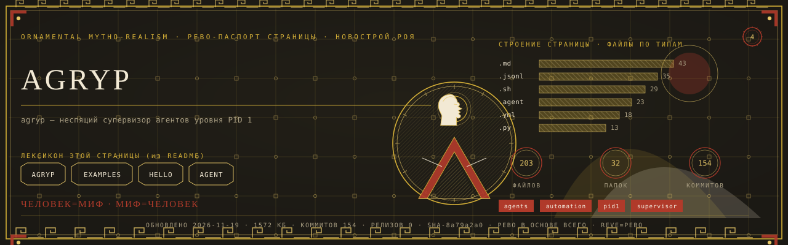

<div align="center">

<a href="https://github.com/rtynbirf/agryp"></a>

</div>

<!--ФОРЖ:МУЗА:НАЧАЛО-->
<div align="center">
  
  <br/>
  
</div>
<!--ФОРЖ:МУЗА:КОНЕЦ-->

<!--ФОРЖ:ПАСПОРТ:НАЧАЛО-->
<div align="center">
  
</div>

| ФАЙЛОВ | ПАПОК | КОММИТОВ | ОБНОВЛЕНО | РЕЛИЗОВ |
|---:|---:|---:|---|---:|
| 211 | 35 | 1 | 2026-11-28 | 2 |
<!--ФОРЖ:ПАСПОРТ:КОНЕЦ-->

# agryp

<p align="center"></p>

<div align="center">

<a href="https://github.com/rtynbirf/agryp"></a>

</div>

<div align="center">
  
</div>


# agryp — неспящий супервизор агентов уровня PID 1

**Агенты умирают в закрытых терминалах. agryp — не спит.**

`agryp` — минимальный init-супервизор, который запускает AI-агентов как
процессы первого класса: политика перезапуска, бюджет попытки (время и
токены), graceful shutdown, клетка cgroups/namespaces, готовность —
файл-договор. Один файл C (`src/agryp.c`), только libc, ноль зависимостей —
этика LFS. Имя — от ἀγύπνος «неспящий»: служба, которая не останавливается
никогда (история имени, ниша и полный разбор — [мануал](docs/MANUAL.md)).

## Быстрый старт

```sh
make && ./agryp --dir examples                   # ферма из examples/*.agent
./agryp status --dir examples                    # живой NDJSON-срез семьи (Ст. 13)
./agrypctl stop hello && ./agrypctl start hello  # файл-договор, не сокет (Виток 5)
kill -HUP $(pgrep -f 'agryp --dir examples')     # перечитать договоры без смерти детей
```

Юнит — файл `.agent` (минимум три строки; полный формат — в мануале):

```ini
name    = hello
exec    = bash demo/hello_agent.sh
restart = always       # ещё: budget-sec, token-budget, cooldown-ms, mem-max-mb, jail, finish…
```

## Что проверено (CI на каждый пуш)

Сборка `gcc -Wall -Wextra -std=c99`; аудиты всех стенограмм витков (аудитор
fail-closed, 13 негативных проб — `make audit-neg`); живая батарея демо
(ctl / finish / ready / reload / stream / envelope / metrics / rotate / sign);
санитайзеры ASan+UBSan; каталог инструментов 2444 позиции × 34 категории;
канон клетки из cell-swarm. Бинарники вне git (аксиома 3) —
[релиз v1.1 → действующие релизы тела](https://github.com/rtynbirf/agryp/releases):
`agryp-linux-x86_64`, `ed25519tool-linux-x86_64`.

## Документы

- [docs/MANUAL.md](docs/MANUAL.md) — полный мануал: история имени, ниша
  (топ-100 GitHub: 40 агентских репо, 0 на уровне процессов), демо-прогоны
  витков 5–11, agrypctl, бенчмарк против сверстников, конверты ed25519,
  архитектура, дорожная карта;
- [CONSTITUTION.md](CONSTITUTION.md) — конституция репо: 16 статей,
  каждая снабжена командой проверки;
- [docs/spec/ROADMAP.md](docs/spec/ROADMAP.md) и [tasks/open/](tasks/open/README.md) —
  витки и очередь воли (норма НОУС);
- [docs/TEACHERS.md](docs/TEACHERS.md) — живая сверка с учителями
  (systemd, s6, runit, tini, supervisord) и сверстниками-2026;
- [KNOWN_ISSUES.md](KNOWN_ISSUES.md) · [SECURITY.md](SECURITY.md) ·
  [AGENTS.md](AGENTS.md) — ограничения, безопасность, протокол агентов-коллег.

## Лицензия

MIT. Собрано с нуля в соответствии с философией Linux From Scratch:
понять слой — значит написать слой.

<!--ФОРЖ:ПОДВАЛ-->
---

<div align="center">
  <sub>◆ картина и штандарт — ручная ковка <a href="https://github.com/rtynbirf">КУЗНИ ПОЛИМАТ</a> · ЧЕЛОВЕК=АККАУНТ=PID1 ◆</sub>
</div>
